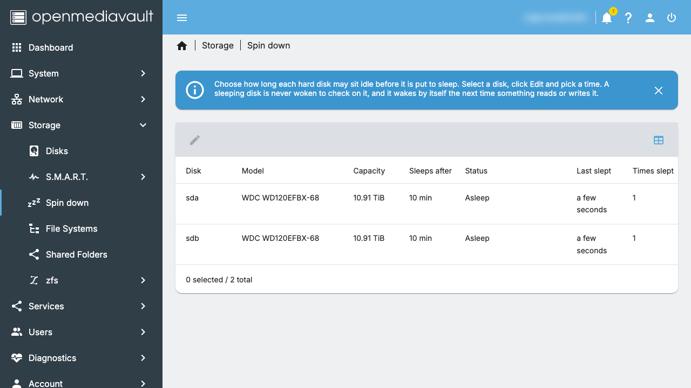
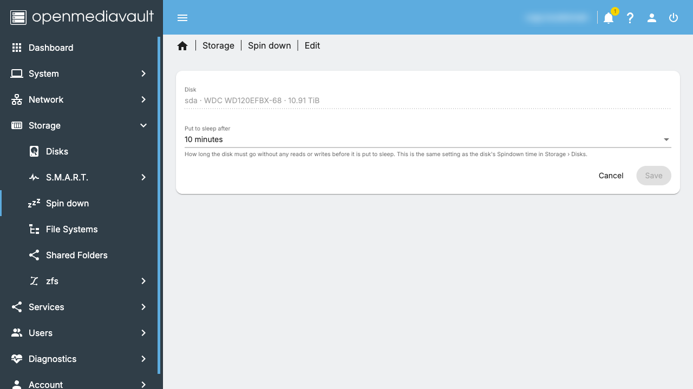

# Make idle hard disks sleep in OpenMediaVault

[Download the latest release](https://github.com/nader-eloshaiker/omv-spindown-plugin/releases/latest){: .btn }
[Source on GitHub](https://github.com/nader-eloshaiker/omv-spindown-plugin){: .btn }

[OpenMediaVault](https://www.openmediavault.org/) (OMV) lets you set a
*Spindown time* for each disk in **Storage › Disks**. It hands that time
to the disk, and the disk is meant to go to sleep by itself once it has
been idle that long. Some disks, notably **WD Red** drives, stop doing
that: they stay spinning day and night, even though nothing is using
them. Yet they still go to sleep straight away when told to.
([OMV issue #1892](https://github.com/openmediavault/openmediavault/issues/1892)
has many reports.)

This plugin does the waiting for them:

- ✅ **Point and click**: pick a disk, click **Edit**, choose how long it may
  sit idle. No commands, no settings files. A Spindown time you already
  set in Storage › Disks is picked up as it is.
- ✅ **Never wakes a sleeping disk.** It watches the kernel's activity
  counters, which does not touch the disk, and the sleep command does
  nothing to a disk that is already asleep.
- ✅ **Puts it back to sleep after every wake-up**, whether a file was
  read or written.
- ✅ **Shows what is going on**: for each disk, whether it is asleep or
  in use, how soon it will sleep, and when it last went to sleep.

Disks that do sleep by themselves are not affected: they are already
asleep when the plugin checks, so it does nothing.

## Install

1. Download `openmediavault-spindown_<version>_all.deb` from the
   [latest release](https://github.com/nader-eloshaiker/omv-spindown-plugin/releases/latest).
2. In the OMV web interface open **System › Plugins**, click **Upload**,
   choose the file, then select the plugin and click **Install**.
3. Open **Storage › Spin down**. It lists your hard disks.
4. Select a disk, click **Edit**, choose **Put to sleep after** (for
   example *10 minutes*) and click **Save**. Do the same for each disk.
5. Click **Apply** in the yellow bar at the top.

The **Status** column then counts down to sleep and shows *Asleep* once
the disk is sleeping. Choose *Never* for a disk that should stay awake.

## Still awake?

The plugin only helps when nothing is using the disk. If the Spin down
page shows a disk that never stays idle for its spindown time, something is
reading or writing it: Docker containers or apps with data on that disk,
media servers scanning libraries, clients browsing shares, or ZFS with
`atime=on`. Move busy app data to an SSD, and keep the hard disks for
bulk storage.

Clicking **Apply** in OMV, or installing a plugin, wakes every hard disk
for a moment: OMV's configuration tool (Salt) scans the disks for LVM
volumes each time it runs. The disks go back to sleep after their time.

## How it works

The time you choose is stored as the disk's *Spindown time*, the same
setting as in Storage › Disks, so both pages always agree. Every 30
seconds `spindownd` reads `/sys/block/<disk>/stat`, the
kernel's count of completed reads and writes. When a disk's count has
not changed for its spindown time, it runs
`smartctl -n standby -s standby,now` on it once. `-n standby` means
smartctl checks the power state first and stops if the disk is asleep,
so a sleeping disk is never woken. Health checks (smartd, temperature
monitors) do not change the counters, so they neither count as use nor
stop the disk from sleeping here.

If a disk is still idle after another spindown time, the plugin asks
again, in case something like a S.M.A.R.T. check woke it without any
reads or writes.

## Common questions

### Why won't my hard disks spin down in OpenMediaVault?

OMV gives each disk its Spindown time, and from then on it is up to the
disk to go to sleep. Many disks, WD Red drives in particular, ignore that
timer and keep spinning. Others never get the chance because something
keeps reading or writing them. The **Status** column on the Spin down
page tells the two apart: a disk that counts down and falls asleep was
ignoring its timer; a disk that keeps showing *In use* is being used.

### Why do WD Red drives never go to sleep?

Their firmware often ignores the standby timer the system gives them,
yet they go to sleep straight away when told to. That is what this
plugin does once the disk has been idle for its spindown time. Many
owners report the same problem in
[OMV issue #1892](https://github.com/openmediavault/openmediavault/issues/1892).

### Will it wake my disks to check on them?

No. It only reads the kernel's activity counters, which never touch the
disk, and its sleep command first checks the power state and does
nothing if the disk is already asleep.

### Does it work with ZFS, RAID or mergerfs?

Yes. It works on each physical disk, whatever is on it. It is used every
day on a ZFS mirror of two WD Red disks. With ZFS, turn `atime` off on
datasets on those disks, or reading a file counts as a write.

### Is it bad for a disk to spin down?

Every start wears the motor a little, and disks are rated for a set
number of start/stop cycles. A disk that sleeps a few times a day is
fine. If a disk keeps waking up every few minutes, choose a longer time
for it, or *Never*.

### Which versions of OpenMediaVault does it work with?

OpenMediaVault 8. It is installed like any other plugin, from one file.

### Where can I read more?

How the problem was tracked down, and how the plugin came about:
[Your NAS disks never spin down? A free fix for OpenMediaVault and WD Red
drives](https://medium.com/@nader.eloshaiker/your-nas-disks-never-spin-down-a-free-fix-for-openmediavault-and-wd-red-drives-986f95cf27f3) on Medium.

## License

Free and open source, GPL-3.0-or-later.
